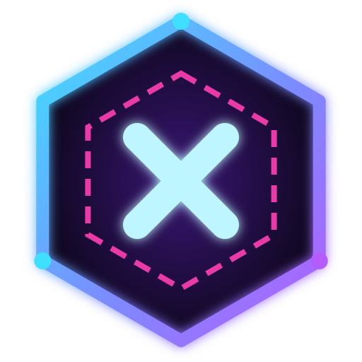

# XDK Hub — téléchargements

Le hub PC de la **TEAM XDK** : tous nos logiciels, jeux Roblox, homebrews PS5 et liens au même endroit, dans le style
néon XDK. **Gratuit**, pour Windows 10 et 11 (64 bits).

## Télécharger

1. Télécharge **[XDK-Hub-Setup.exe](https://github.com/XDTEAMDev/XDK-Hub-releases/releases/latest/download/XDK-Hub-Setup.exe)**
   (ou ouvre la [dernière version](https://github.com/XDTEAMDev/XDK-Hub-releases/releases/latest)).
2. Lance-le : le hub s'installe tout seul et crée un raccourci sur le Bureau.

Au premier lancement, Windows peut afficher « Windows a protégé votre ordinateur » : clique sur
« Informations complémentaires » puis « Exécuter quand même ».

## Ce qu'il fait

- **Logiciels PC** : un clic pour installer, puis « Lancer ». Chaque fichier est comparé à l'empreinte SHA-256 publiée
  par GitHub avant d'être gardé, et tes apps restent à jour toutes seules.
- **Jeux** : tous les jeux Roblox de la TEAM XDK, avec le bouton « Jouer » (Roblox s'ouvre directement s'il est installé),
  les miniatures, les visites et les favoris.
- **PS5 & mods** et **Android TV** : XDK Mod Menus, XDK Launcher… à télécharger dans `Téléchargements\XDK Hub`.
- **Communauté** : nos Discord, le groupe Roblox, nos réseaux.
- **Toujours à jour** : chaque nouvelle app ou nouveau jeu de la team apparaît tout seul (badge NOUVEAU et notification
  Windows), et le hub reçoit ses propres nouvelles versions automatiquement.
- Recherche (Ctrl+K), « Ma bibliothèque » pour retrouver tes apps, et le hub peut rester discret près de l'horloge.

## Ce dépôt

Il contient les versions à télécharger de XDK Hub et son catalogue (`catalogue.json`), que tous les hubs relisent
régulièrement. Les autres logiciels de XDK TEAM DEV ont leurs propres pages.

Discord XDK TEAM DEV : https://discord.gg/zEC35KSuxt
